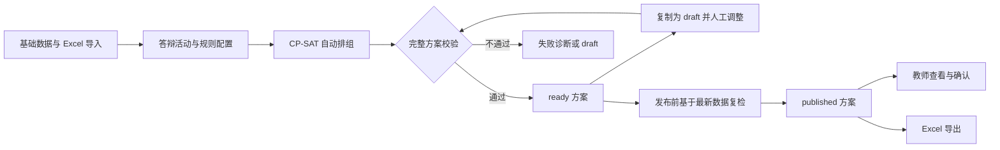
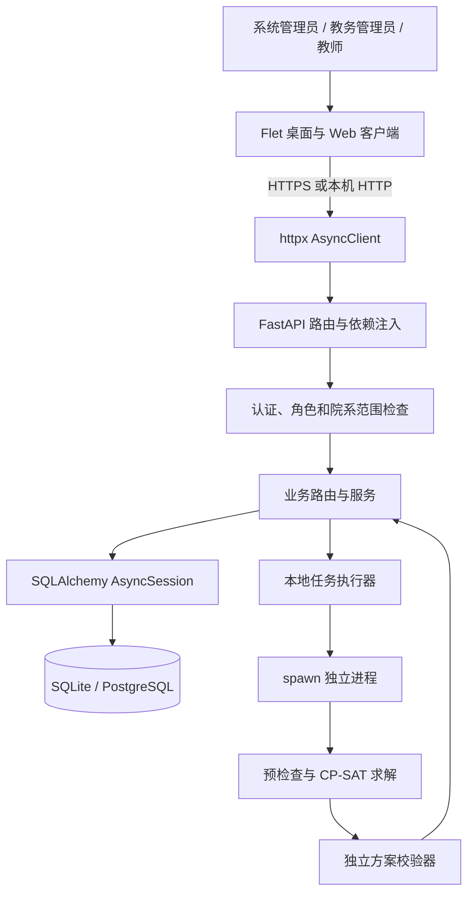
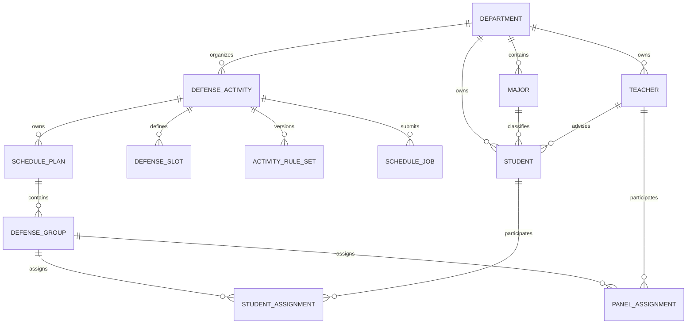
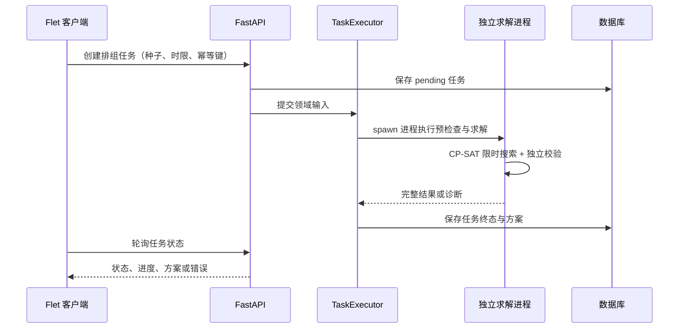
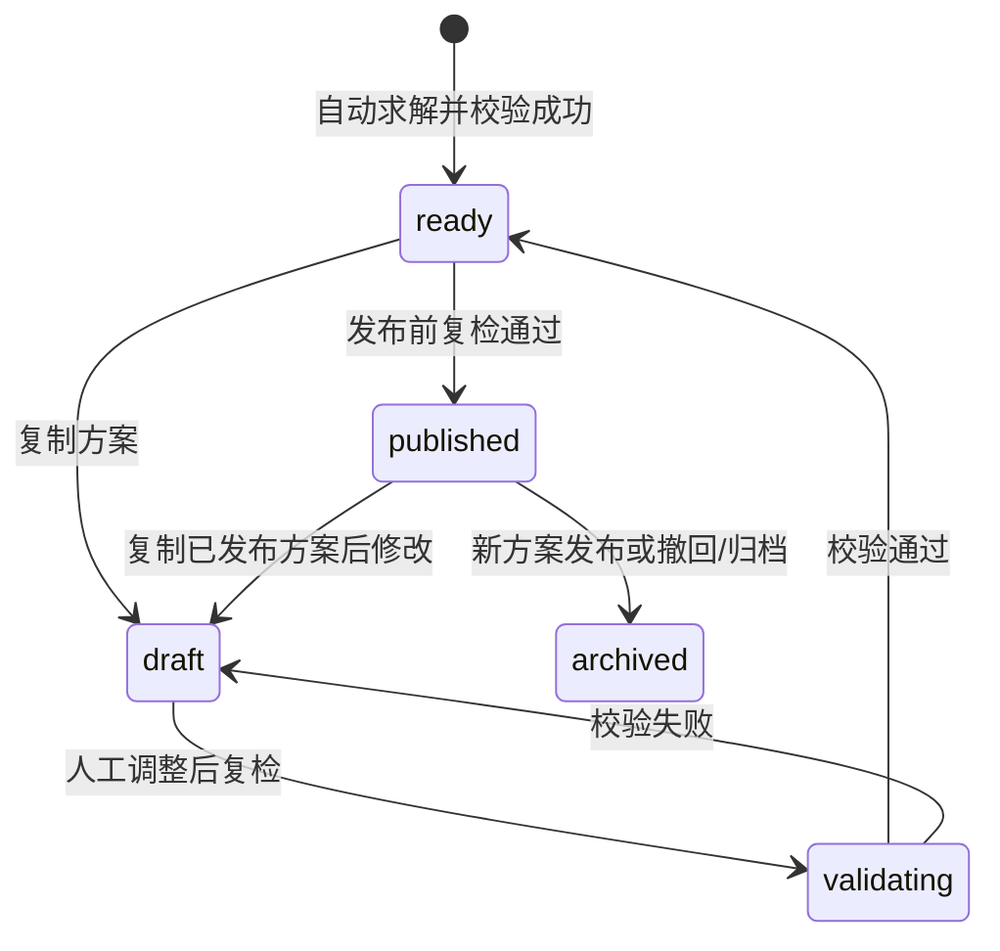

# 答辩分组系统技术报告

| 项目 | 内容 |
| --- | --- |
| 项目名称 | 答辩分组系统（defense-grouping-system） |
| 项目版本 | 0.3.0（以 `pyproject.toml` 为准） |
| 报告日期 | 2026 年 10 月 x 日 |

## 摘要

答辩分组需要同时协调学生、教师、时段和教室，并处理导师回避、课程冲突、请假、组长资格及教师工作量等条件。人工排组不仅工作量大，而且在局部调整后容易遗漏全局冲突。本项目将这一过程实现为覆盖“数据准备—活动配置—自动排组—人工调整—独立校验—方案发布—教师确认”的业务系统。

系统采用 Flet 构建桌面与 Web 客户端，使用 FastAPI 提供业务接口，通过 SQLAlchemy Async 访问 SQLite 或 PostgreSQL，并以 OR-Tools CP-SAT 建立约束优化模型。模型先保证学生分配、导师回避、人员与教室不重复占用等硬约束，再通过加权和优化组人数均衡、教师工作量均衡、方向匹配、时间安排紧凑度和例外使用数量。求解结果由独立校验器复检，发布前还会基于最新业务数据再次验证，避免过期方案直接生效。

本报告依据当前代码说明系统需求、总体架构、数据设计、排组算法、业务流程、安全机制、接口与任务模型、测试证据和部署方法，同时明确现阶段的实现边界。报告中的性能数据引用仓库历史验收记录，不代表本次重新测量的结果。

**关键词：** 答辩分组；约束规划；CP-SAT；FastAPI；Flet；SQLAlchemy

## 1. 项目概述

### 1.1 建设背景

答辩安排不是简单的学生均分问题。每个答辩组都需要符合人数要求的评审教师和具备相应职称的组长，还要占用一个有效时段与一间容量足够的教室。学生导师通常需要回避本人指导学生的评审；教师和学生的课程、已批准请假会进一步压缩可安排范围。教师可承担的工作量、研究方向匹配程度及时间间隔又会影响方案质量。

这些条件相互耦合。例如，调整一个组的时段，可能同时引起教师课程冲突、教室重复占用和组长资格变化。因此，系统不能只保存分组名单，而应将约束检查、优化计算、人工修改和发布控制组织为完整流程。

### 1.2 建设目标

1. 集中维护院系、专业、方向、师生、学期、课程、请假、教室等基础数据。
2. 将答辩规则转化为可计算、可复检的硬约束和软目标，自动生成完整方案。
3. 支持方案复制、人工调整、版本比较和失败诊断，兼顾自动计算与人工决策。
4. 通过角色、院系范围和本人数据隔离控制访问，保留例外审批及操作审计记录。
5. 支持 Excel 数据交换、已发布方案导出以及数据库备份恢复。
6. 同时提供本机 SQLite 运行方式和 PostgreSQL 服务器部署路径。

### 1.3 系统边界

当前系统聚焦答辩组织与资源安排，不包含论文全文管理、查重、成绩评定、答辩过程记录或通用教学排课。教师“确认”表示确认收到安排，不表示答辩已经完成。

自动排组当前读取活动所属院系内**全部启用学生和教师**，并非由活动单独选择部分师生参与。若只需安排其中一部分人员，现有公开流程需要通过人员启用状态或院系数据范围进行控制，这也是后续可按实际业务改进的方向。

## 2. 需求与角色分析

### 2.1 用户角色

| 角色 | 主要职责 | 数据范围 |
| --- | --- | --- |
| 系统管理员 `system_admin` | 用户、角色、账号状态及系统治理 | 全局；审计查询仅向该角色开放 |
| 教务管理员 `academic_admin` | 主数据维护、导入、活动配置、排组、方案发布和例外处理 | 已授权院系；审批还需专门的审批权限标记 |
| 教师 `teacher` | 查看本人已发布安排并确认 | 通过与用户账号关联的教师档案隔离 |

后端同时检查角色和院系范围，不能仅依赖客户端菜单隐藏实现授权。教师安排通过 `Teacher.user_id` 与当前用户匹配，而不是只按教师角色判断。

### 2.2 功能需求

| 业务模块 | 已实现能力 |
| --- | --- |
| 主数据 | 院系、专业、方向、教师、学生、学期、教室及方向关联维护 |
| 可用性 | 课程占用、已批准请假、教室可用区间和活动时段管理 |
| 数据导入 | 六类 Excel 模板、预检、错误定位、写入预览和人工确认 |
| 活动配置 | 组容量、教师人数、组长职称、工作量、五项权重、时段与教室配置 |
| 自动排组 | 后台任务、状态查询、取消、可行方案保存及不可行诊断 |
| 方案管理 | 复制、调整、比较、独立复检、发布、撤回/归档和导出 |
| 例外审批 | 申请、批准、驳回、撤销、有效期和精确适用对象控制 |
| 教师端 | 查看已发布的本人安排、确认接收 |
| 运维治理 | 用户权限、审计查询、SQLite 备份恢复、数据库迁移和构建验证 |

### 2.3 非功能需求

- **正确性：** 任何发布方案都必须通过完整业务校验，不能只相信求解器返回值。
- **一致性：** 导入确认、方案发布等多表写入使用事务；并发修改通过版本号识别。
- **隔离性：** 教务数据按院系授权，教师只能访问本人任务。
- **可追踪性：** 保存请求标识、例外审批、导入批次、方案参数和审计摘要。
- **可维护性：** 客户端、接口、业务域、算法与持久化代码分包组织，使用迁移管理表结构。
- **可用性：** 计算任务与请求处理分离，支持桌面和 Web 两种客户端形态。
- **安全性：** 密码哈希、短期访问令牌、刷新令牌轮换、登录限速和敏感审计字段脱敏。

## 3. 总体设计

### 3.1 系统上下文与业务闭环



系统把“计算任务”和“答辩方案”分开保存。任务失败或取消不会覆盖已有方案；同一活动可以保留多个版本用于比较，但发布时会归档同活动的旧发布方案。

### 3.2 分层架构



实际代码采用“按业务域组织的路由 + 服务 + ORM”，并非严格的 Controller–Service–Repository 架构：部分查询和写入仍直接位于路由函数中。这样减少了小型项目的抽象层，但较大的路由和服务模块需要持续控制复杂度。

### 3.3 技术选型

| 层次 | 主要技术 | 在项目中的作用 |
| --- | --- | --- |
| 运行环境 | Python 3.12–3.14、uv | 统一客户端、服务端与算法实现，锁定依赖 |
| 客户端 | Flet 1.x、httpx | 同一套 Python UI 支持桌面和 Web，异步访问 API |
| 接口 | FastAPI、Pydantic、Uvicorn | 参数校验、依赖注入、接口文档和服务运行 |
| 持久化 | SQLAlchemy 2 Async、Alembic | 异步数据访问、版本化数据库迁移 |
| 数据库 | SQLite/aiosqlite、PostgreSQL/asyncpg | 分别支持本机与服务器部署 |
| 排组 | OR-Tools CP-SAT | 表达布尔分配、整数容量和加权优化 |
| 数据交换 | openpyxl | Excel 模板、预检、导入和已发布方案导出 |
| 安全 | pwdlib/Argon2、PyJWT、keyring | 密码哈希、JWT 和桌面凭据存储 |
| 工程质量 | pytest、Hypothesis、Ruff、mypy、testcontainers | 测试、属性校验、静态检查和 PostgreSQL 验证 |

项目没有独立的 JavaScript/TypeScript 前端。Web 客户端同样由 Flet Python 应用构建，这与“FastAPI + 独立前端单页应用”的结构不同。

### 3.4 代码组织

| 路径 | 职责 |
| --- | --- |
| `src/defense_grouping/client/` | 页面、路由、会话、API 客户端和通用组件 |
| `src/defense_grouping/api/` | 应用组装、依赖、错误处理和通用审计中间件 |
| `src/defense_grouping/auth/` | 登录、令牌、用户、角色、限速与权限 |
| `src/defense_grouping/master_data/` | 主数据、活动及资源接口和业务检查 |
| `src/defense_grouping/scheduling/` | 领域输入、预检查、求解、校验、任务和方案生命周期 |
| `src/defense_grouping/imports_exports/` | Excel 模板、导入事务与方案导出 |
| `src/defense_grouping/governance/` | 例外审批、审计和备份恢复 |
| `src/defense_grouping/models/`、`db/` | ORM 模型、公共字段和异步会话 |
| `alembic/`、`tests/`、`scripts/` | 数据库迁移、自动测试和开发运维脚本 |

## 4. 数据设计

### 4.1 领域实体

当前 ORM 注册 28 张业务表，可按以下领域理解：

| 数据领域 | 主要实体 | 核心关系与用途 |
| --- | --- | --- |
| 身份权限 | User、RoleAssignment、RefreshToken | 用户角色、院系范围和刷新会话 |
| 组织与人员 | Department、Major、Direction、Teacher、Student | 院系归属、学生导师、教师账号关联 |
| 方向关联 | TeacherDirection、StudentDirection | 教师、学生与方向的多对多关系 |
| 学期与占用 | AcademicTerm、CourseOccupancy、LeaveRecord | 学期、课程冲突和请假记录 |
| 空间资源 | Room、RoomAvailability | 教室容量与可用区间 |
| 活动配置 | DefenseActivity、DefenseSlot、ActivityRoom、ActivityRuleSet | 活动、标准时段、教室池和规则版本 |
| 排组结果 | ScheduleJob、SchedulePlan、DefenseGroup | 任务、方案版本和答辩组 |
| 分配与确认 | PanelAssignment、StudentAssignment、TeacherConfirmation | 教师/学生分配和教师确认 |
| 业务治理 | ConstraintException、ImportBatch、AuditLog | 例外、导入过程和操作追踪 |

主要实体使用 UUID，并保存创建时间、更新时间和应用层 `version`。ORM 中较少使用 `relationship()`，业务代码主要通过显式 `select()` 和 `join()` 组合查询，便于看清数据访问，但也要求调用方正确处理关联逻辑。

### 4.2 核心关系



该图突出主要业务关系，不替代完整的 Alembic 表结构定义。

### 4.3 完整性与并发控制

数据库唯一约束覆盖学号、工号、院系内专业/方向编码、活动规则版本、任务幂等键、方案版本、组号及“方案 + 时段 + 教室”等关键组合。同一学生在同一方案中只能出现一次，同一组教师不能重复。外键按业务需要采用 `CASCADE`、`RESTRICT` 或 `SET NULL`；SQLite 每个连接显式启用 `PRAGMA foreign_keys=ON`。

需要明确的是，数据正确性由多层共同保证，不能全部归因于数据库：

- Pydantic 检查正数、字符串长度、时间范围等输入格式；
- 业务服务检查院系归属、引用关系、状态流转和版本冲突；
- 独立校验器检查完整排组方案；
- 数据库负责已声明的主键、外键和唯一约束。

例如，课程/请假的多态人员标识、例外人员标识没有统一数据库外键；同一活动时段“不得部分重叠”也不是数据库约束。因此，新增写入入口时必须复用业务校验，而不能只依赖 ORM 模型。

## 5. 自动排组模型

### 5.1 输入构造

`SchedulingInput` 是跨进程传递的不可变领域输入，包含活动标识、随机种子、学生、教师、时段、教室、规则、已批准例外以及课程和请假冲突。

构造规则包括：

1. 读取活动当前规则版本及所属院系的全部启用师生。
2. 只将已批准请假纳入不可用时间；未批准请假不影响排组。
3. 只接受当前活动内已批准且未过期的例外。
4. 答辩时段按 Asia/Shanghai 转为 UTC，与课程和请假区间做重叠判断。
5. 教室没有可用性记录时，默认其在活动时段可用；存在记录时，要求可用区间完整覆盖答辩时段。
6. 对学生、教师和资源标识稳定排序，以提高重复运行的一致性。

设学生数为 `N`，每组学生上限为 `C`，目标组数固定为：

```text
G = ceil(N / C)
```

组数不是优化变量。该设计直接确定模型规模，但在资源不足时可能导致不可行，而不会通过自动增加组数寻找安排。

### 5.2 决策变量

| 变量 | 类型 | 含义 |
| --- | --- | --- |
| `x(s,g)` | 布尔 | 学生 `s` 是否进入组 `g` |
| `y(t,g)` | 布尔 | 教师 `t` 是否参加组 `g` |
| `z(g,k)` | 布尔 | 组 `g` 是否使用时段 `k` |
| `r(g,j)` | 布尔 | 组 `g` 是否使用教室 `j` |
| `c(t,g)` | 布尔 | 教师 `t` 是否担任组 `g` 的组长 |

模型还使用人数、工作量、资源事件和例外使用等辅助变量，并通过线性约束表达“教师参加某组且该组位于某时段”等组合条件。资源对排序和组人数非增等约束用于减少等价排列，降低对称性带来的搜索开销。

### 5.3 硬约束

硬约束决定方案是否可发布，优先级高于任何软目标：

1. 每名学生恰好进入一组，每组人数不超过上限。
2. 每组教师人数精确等于配置值。
3. 每组恰有一名组长；组长必须属于本组并满足最低职称要求。
4. 每组恰好选择一个时段和一间教室。
5. 导师不得参加本人指导学生所在组，除非存在精确匹配的已批准例外。
6. 人员不可用时段禁止安排；课程或请假例外只对明确人员和时段生效。
7. 同一学生、教师和教室在同一时段最多使用一次。
8. 教室在对应时段必须可用，容量不得小于该组学生人数。
9. 同一时段并行组数不得超过活动时段的 `max_groups`。
10. 教师工作量不得超过个人上限与活动上限中的较小值，除非存在该教师的工作量例外。

支持的例外只有四类：`advisor_conflict`、`course_conflict`、`leave_conflict` 和 `workload_limit`。例外不能放宽教室容量、组长资格、教师人数或重复占用等规则。工作量例外允许突破原上限，但最终仍受组数和人员不重复占用约束。

### 5.4 软约束与目标函数

模型最小化五项非负加权和：

```text
min F = w1 × B_students + w2 × B_teachers
      + w3 × D_mismatch + w4 × T_gaps + w5 × E_used
```

| 指标 | 代码中的实际含义 |
| --- | --- |
| `B_students` | 最大组人数与最小组人数之差 |
| `B_teachers` | 各教师工作量相对整体平均分配的缩放绝对偏差之和 |
| `D_mismatch` | 所在组没有教师与其方向相交的学生数量 |
| `T_gaps` | 同一教师使用的各时段对之间的序号间隔惩罚之和 |
| `E_used` | 实际触发的不同已批准例外数量 |

该模型是**单目标加权优化**，不是字典序、多阶段或 Pareto 优化。`T_gaps` 不是实际等待分钟数，`B_teachers` 也不是直接方差。各指标尺度不同，相同权重不代表相同影响；权重只改变可行方案之间的偏好，不能突破硬约束。

### 5.5 求解、诊断与复现



API 默认随机种子为 `20260918`，范围为 `0..2147483647`；求解时限默认 60 秒，必须大于 0 且不超过 600 秒。CP-SAT 使用固定种子和单搜索工作线程。固定种子有利于复现，但限时搜索、依赖版本和机器差异仍可能改变结果，不能承诺跨环境完全一致。

求解状态处理如下：

- `optimal`：已证明当前模型目标最优；
- `feasible`：找到完整可行解，但未证明最优；
- `infeasible`：模型不可行，结合预检查和约束族给出诊断；
- `timeout`：时限内没有完整方案，不保存部分安排。

达到时限但已有完整解时按 `feasible` 保存。不可行诊断用于定位相关条件，不保证是最小冲突集或唯一修复方案。

### 5.6 独立校验与发布前复检

`validator.py` 重新检查输出中的成员分配、导师关系、人员与教室占用、容量、工作量及例外适用范围，不信任 CP-SAT 的内部状态。自动求解保存、人工调整、方案复检和发布前都使用业务校验。

发布前会基于当前数据库重新构造输入。由此可以识别求解完成后新增的课程、请假、规则变化或例外撤销；如果方案不再有效，发布不会继续。这一“求解与验收分离”的设计是系统正确性的关键保障。

## 6. 关键业务实现

### 6.1 方案生命周期

方案状态包括 `draft`、`validating`、`ready`、`published` 和 `archived`，主要流转为：



只有草稿允许人工调整，调整时立即对完整方案复检，失败则回滚修改。已发布方案不可原地编辑，需要复制形成新草稿。发布只接受 `ready`，并在同一业务事务中归档旧发布方案、发布新方案、生成教师确认和写发布审计。

方案比较覆盖学生、教师、时段、教室、目标分数和例外使用变化。教师只能查询已发布方案中的本人任务，确认操作不改变方案内容。

### 6.2 后台任务模型

排组使用 `ProcessPoolExecutor(max_workers=1)`，多进程上下文为 `spawn`。API 进程与工作进程之间传递可序列化领域数据，不共享数据库会话。任务状态包括等待、运行、成功、失败和取消。

服务端按“创建人 + 幂等键”识别重复任务；同一键用于其他活动会返回冲突。幂等键与请求追踪用的 `X-Request-ID` 是不同机制。当前排组页面每次新的开始操作都会生成新的 UUID，因此不能将页面行为描述为“重复点击自动复用同一幂等键”。

该执行器不是 Celery/RQ 等持久队列：应用重启会把检测到的运行中任务标为失败，不会自动续算；取消异步包装任务也不等于显式终止已运行的子进程。当前实现适合受控单实例部署，不宜直接推断为多实例分布式调度能力。

### 6.3 Excel 导入

支持学生、教师、课程、请假、答辩时段和教室六类 `.xlsx` 导入，文件上限 20 MiB、最多 20,000 数据行。流程为：

```text
上传并保存原文件
→ 解析模板、字段和业务引用
→ 生成 ready/failed 预检结果
→ 人工预览并确认
→ 重新比较文件 SHA-256
→ 单事务写入及审计
→ confirmed；失败则回滚业务写入
```

确认前重新校验文件摘要，避免预检后替换文件。学号、工号和来源指纹等标识用于匹配已有数据，因此重复导入可能更新字段，操作人员仍需查看预览。

一个需要保留的实现边界是：手工 API 创建或更新活动时段会检查区间重叠，但当前 Excel 时段导入只检查字段、先后关系、并行组数和完全相同区间，未完整检查与其他区间的部分重叠。因此，“同活动时段不重叠”尚不是所有入口共同保证的全局不变量。

### 6.4 方案导出

只允许导出**已发布**方案。工作簿包含六个工作表：分组总表、教师安排、学生安排、教室时段、冲突与例外、方案信息。当前没有通用主数据、审计日志、CSV 或 PDF 导出接口。

### 6.5 例外审批与审计

例外申请需要明确对象、有效到期时间和不少于 10 个字符的原因。申请人不能审批自己的申请；审批人必须是系统管理员，或同院系、启用且具有 `can_approve_exceptions=True` 的教务管理员。过期申请不能批准，方案会保存实际使用例外的快照。

撤销已批准例外时，当前代码要求管理角色及院系范围，但没有再次检查专门审批权限，也不要求必须由原审批人执行。报告和权限设计评审时应以这一实际行为为准。

审计有两个来源：业务服务显式记录发布、审批、导入等领域事件；HTTP 中间件为成功的写请求追加通用审计。二者可能同时出现，且通用审计使用独立会话，不能声称所有审计与业务写入都处于同一事务。系统为请求生成 `X-Request-ID`，审计摘要会递归遮盖密码、令牌和密钥等敏感字段。ORM `before_flush` 事件阻止普通 ORM 修改或删除审计，但这不能替代数据库权限隔离或外部不可变日志。

## 7. 接口、认证与安全

### 7.1 API 结构

当前代码包含 83 个 HTTP 方法—路径组合，包括健康检查及 `withdraw/archive` 两个归档别名。除健康检查外，业务接口统一位于 `/api/v1`。

| 模块 | 数量 | 代表性路径 |
| --- | ---: | --- |
| 健康检查 | 1 | `GET /api/v1/health` |
| 认证与用户 | 10 | `/auth/login`、`/auth/refresh`、`/users`、`/users/{id}/roles` |
| 主数据与活动 | 47 | `/departments`、`/teachers`、`/students`、`/activities` 及子资源 |
| 排组与方案 | 14 | `/schedule-jobs`、`/plans/{id}/validate`、`/plans/{id}/publish` |
| 导入导出 | 5 | `/imports/templates/{kind}`、`/imports/{kind}/preflight`、`/plans/{id}/export` |
| 例外与审计 | 6 | `/exceptions`、`/exceptions/{id}/approve`、`/audit-logs` |

主数据十组资源均提供集合查询/创建和单项修改/删除接口。教师和学生的删除操作实际为停用，不是物理删除。完整、实时的字段定义应以运行服务的 `/docs` 和各模块 `schemas.py` 为准。

### 7.2 认证与会话

密码使用 Argon2 哈希。访问令牌为 HS256 JWT，包含用户主体、类型、签发与过期时间以及强制改密标记；刷新令牌使用安全随机字符串，数据库只保存 SHA-256 摘要。刷新时撤销旧记录并签发新记录，密码修改、重置和账号停用会撤销相关刷新令牌。

访问令牌没有独立的服务端撤销列表，通常需等待短期过期；但受保护接口会重新读取用户状态、启用标记和角色，不只信任令牌中的角色信息。首次改密同样以数据库用户状态为准。

登录限速按“规范化用户名 + IP”统计，15 分钟内最多 5 次失败，计数保存在进程内存中，重启或多实例环境不共享该状态。配置类默认访问令牌有效期 15 分钟、刷新令牌 30 天；`.env.example` 将刷新期限设为 7 天，实际部署以最终环境变量为准。

### 7.3 客户端凭据与传输

桌面客户端使用操作系统密钥环保存刷新令牌；Web 客户端使用 Flet SharedPreferences。API 客户端在访问令牌失效时自动刷新并重试一次，不保存用户密码。

Web 部署应采用 HTTPS 和同源 `/api/` 反向代理。当前 FastAPI 应用未配置跨域中间件，这与推荐的同源部署一致。浏览器本地凭据仍需通过站点安全、设备管理和及时退出登录保护。

### 7.4 教师账号关联边界

教师端依赖 `Teacher.user_id` 将登录用户映射到教师档案。数据库模型和测试数据支持该关联，但当前教师创建/更新 Schema 和系统管理界面均未提供建立或修改 `user_id` 的公开流程，测试中的教师端到端流程依赖预置关联数据。正式部署前需要通过受控数据初始化补齐关联，或优先实现对应管理功能，否则教师可能无法看到本人安排。

## 8. 测试与质量证据

### 8.1 测试体系

当前测试树静态包含 23 个测试文件、111 个测试函数；考虑两处参数化后约对应 114 个用例实例。其中 Hypothesis 属性测试在执行时还会生成多组输入。

| 类型 | 静态实例数 | 主要覆盖 |
| --- | ---: | --- |
| 单元测试 | 24 | 求解器、预检查、独立校验、安全和应用启动 |
| 集成测试 | 42 | API、权限、导入、审批、方案、审计、备份、迁移和 PostgreSQL |
| 客户端测试 | 34 | API 客户端、角色导航、会话、工作流与视图交互 |
| 端到端控制流 | 2 | 管理员到教师流程、真实 API/数据库与控件事件联动 |
| 仓库治理 | 11 | GitHub、CI、ruleset 和发布合约 |
| 性能 | 1 | 500 学生、50 教师、20 组规模 |

端到端测试通过 ASGI transport 和 Flet `FakePage`/控件事件处理执行，不是 Playwright 或 Selenium 真实浏览器自动化。仓库另有人工浏览器登录恢复验收记录。

关键正确性测试包括：同种子重复求解、精确例外生效、无效组长与容量预检、重复分配和重叠占用检测、任务幂等与取消、方案版本冲突、发布不可变、发布前数据变化、自审批禁止、审计脱敏、导出工作表、SQLite 备份恢复及 PostgreSQL 核心流程。

### 8.2 历史验收结果

以下数据引用 `docs/verification/first-release.md`，记录于 2026 年 9 月 18—19 日，属于当时环境和代码基线：

| 项目 | 仓库记录 |
| --- | --- |
| 平台 | Manjaro Linux x86_64，Python 3.13.9 |
| 关键环境 | SQLite 3.50.4、PostgreSQL 17、Flet 1.0.0、OR-Tools 9.15.6755 |
| 完整测试套件 | 113 passed，1 conditional skip，1 warning |
| PostgreSQL 专项 | 显式启用后 1 passed |
| 性能输入 | 500 名学生、50 名教师、20 组、8 个时段、24 间教室 |
| 性能耗时 | 墙钟 23.48 秒，求解 21.90 秒 |
| 求解进程峰值 RSS | 719.8 MiB |
| 构建与迁移 | 记录了 Web 构建、Python 包构建和 Alembic 检查成功 |

性能测试预算为总墙钟不超过 65 秒、求解不超过 60 秒、工作进程峰值 RSS 小于 2 GiB，并要求最终方案通过独立校验。该数据集将五项软目标权重设为 0，主要衡量建模和获取首个可行解的成本，不是优化质量基准。单次历史结果不能推出所有 500 人场景都具有相同耗时，也不能证明多并发性能。

### 8.3 CI 与本次验证范围

PR Gate 覆盖静态检查、仓库治理测试、Python 3.12/3.13/3.14 的单元/集成/客户端测试、PostgreSQL 专项和 Flet Web 构建。性能测试由独立工作流执行，`tests/e2e` 和性能测试不应仅凭 PR Gate 名称推断为每次必跑。

本次重写完成了源代码、配置、测试和历史文档的静态核对，未重新安装依赖、启动系统或执行测试与性能测量，因此不新增当前环境的通过率、覆盖率或吞吐量结论。

## 9. 运行与部署

### 9.1 本地开发

在项目根目录准备 Python 3.12–3.14 和 uv。Windows PowerShell 可执行：

```powershell
Set-Location "D:\Homework\SSAD Lab\defense-grouping-system"
uv sync --locked --python 3.12
if (-not (Test-Path -LiteralPath .env)) {
    Copy-Item .env.example .env
}
uv run python -c "import secrets; print(secrets.token_urlsafe(48))"
notepad .env
```

将生成的随机字符串填入 `DEFENSE_JWT_SECRET`，替换示例占位值。密钥至少 32 个字符。默认数据库为 `sqlite+aiosqlite:///./data/defense_grouping.db`，随后执行：

```powershell
New-Item -ItemType Directory -Force data | Out-Null
uv run alembic upgrade head
uv run defense-grouping init-admin --username admin
uv run python scripts/dev.py
```

保存命令行一次性显示的临时密码，首次登录后立即改密。`scripts/dev.py` 会启动 API、等待健康响应并启动 Flet 客户端；按 `Ctrl+C` 停止。常用地址：

- 健康检查：`http://127.0.0.1:8765/api/v1/health`
- 接口文档：`http://127.0.0.1:8765/docs`

健康接口只返回服务状态和根据连接串推断的数据库类型，没有实际查询数据库，不能单独证明数据库就绪。

### 9.2 配置来源

`Settings` 读取环境变量和 `.env`。一键开发脚本还会生成 `.runtime/local.env` 并向子进程注入同名变量，这些值优先于应用 `.env`，涉及数据库、JWT 密钥和 API 端口。排查配置问题时应先确认实际生效来源。

Alembic 的 `env.py` 从系统环境变量读取 `DEFENSE_DATABASE_URL`，否则使用 `alembic.ini` 默认值，并不自动加载应用 `.env`。自定义数据库时，应让迁移、管理员初始化和 API 使用相同连接串，例如：

```powershell
$env:DEFENSE_DATABASE_URL = "sqlite+aiosqlite:///./data/custom.db"
uv run alembic upgrade head
```

随后同步运行时配置，避免不同命令连接不同数据库。

### 9.3 桌面、Web 与服务器

桌面模式在未配置外部 `DEFENSE_API_URL` 时检查本机 `127.0.0.1:8765`，没有可用 API 则自动启动 Uvicorn sidecar。单独启动 API 可使用：

```bash
uv run uvicorn defense_grouping.api.main:create_app --factory --port 8765
```

Web 客户端通过 `uv run flet build web --yes` 构建，部署时使用 HTTPS 和同源反向代理，将 `/api/` 转发到 FastAPI。服务器数据库可使用 `postgresql+asyncpg://...`，先执行迁移，再以受控单实例运行 API。当前本地任务执行器不提供跨实例共享调度语义，不建议未经改造直接水平扩展多个 API 实例。

SQLite 备份使用在线备份 API，生成包含 SHA-256、创建时间和 Alembic revision 的 manifest；恢复时校验摘要和 schema revision，先备份当前库，再以临时文件和原子替换完成恢复。PostgreSQL 备份恢复按运维文档使用 `pg_dump/pg_restore`，不属于应用内 CLI 功能。数据库结构迁移不等于业务数据自动搬迁，服务器迁移还需核对记录数量和业务汇总并演练恢复。


## 10. 结论

答辩分组系统已经形成较完整的业务闭环。其核心价值不只是调用 CP-SAT 生成名单，而是将主数据、活动规则、例外审批、后台求解、独立校验、人工调整、版本发布和教师确认连接起来。固定组数的硬约束模型保证基本可执行性，五项加权目标用于在可行方案中表达质量偏好；发布前基于最新数据复检，则降低了过期计算结果直接生效的风险。

从工程形态看，项目适合本机或受控单实例部署，并具备 PostgreSQL 迁移、测试和运维文档基础。

## 11. 参考资料与代码索引

以下链接相对于本报告所在的 `docs/` 目录：

1. [项目说明](../README.md)与[依赖配置](../pyproject.toml)。
2. [API 应用入口](../src/defense_grouping/api/main.py)与[客户端入口](../src/defense_grouping/client/main.py)。
3. [数据库模型](../src/defense_grouping/models/)与[数据库公共类型](../src/defense_grouping/db/base.py)。
4. [排组领域模型](../src/defense_grouping/scheduling/domain.py)、[求解器](../src/defense_grouping/scheduling/solver.py)、[预检查](../src/defense_grouping/scheduling/precheck.py)及[独立校验器](../src/defense_grouping/scheduling/validator.py)。
5. [排组与方案服务](../src/defense_grouping/scheduling/service.py)及[任务执行器](../src/defense_grouping/scheduling/executor.py)。
6. [认证安全实现](../src/defense_grouping/auth/security.py)、[权限实现](../src/defense_grouping/auth/permissions.py)及[审计实现](../src/defense_grouping/governance/audit.py)。
7. [导入服务](../src/defense_grouping/imports_exports/import_service.py)、[导出服务](../src/defense_grouping/imports_exports/export_service.py)及[备份恢复](../src/defense_grouping/governance/backup.py)。
8. [首版与完整界面验收记录](verification/first-release.md)及[院系规模性能测试](../tests/performance/test_department_scale.py)。
9. [本地开发](operations/local-development.md)、[服务器迁移](operations/server-migration.md)、[备份恢复](operations/backup-recovery.md)及[登录会话](operations/login-session.md)。
10. [CI 工作流](../.github/workflows/ci.yml)与[中文使用手册](wiki/Home.md)。
